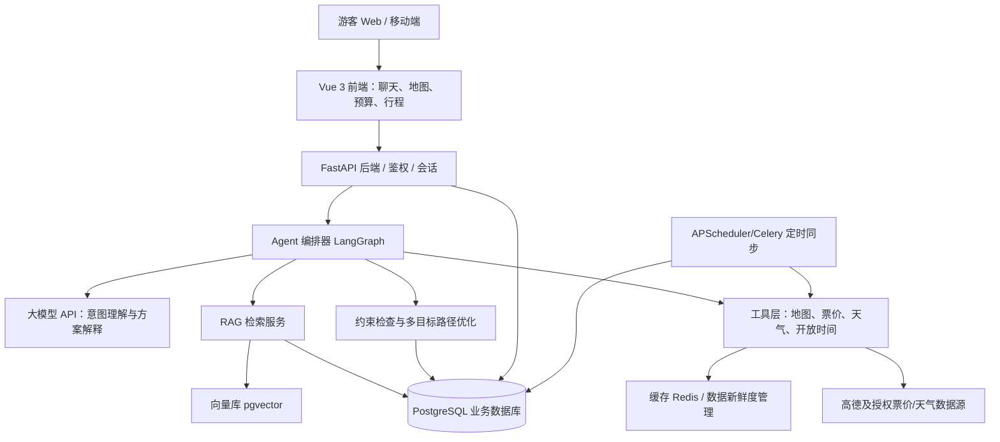
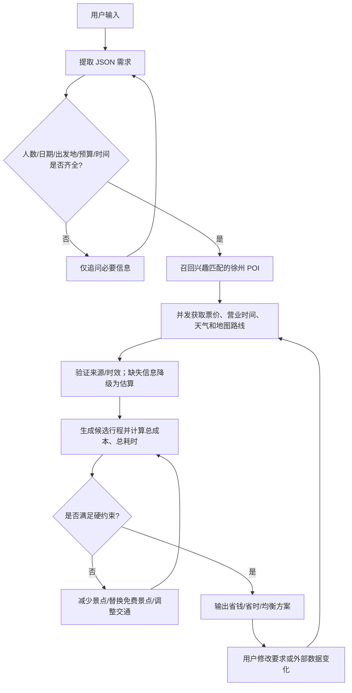

# 彭城智游——基于大模型与实时数据融合的徐州智慧文旅 Agent

> 项目定位：大学生计算机设计大赛 / AI 创新比赛；技术基线：Python 3.13.9 + SQL 数据库。版本：V1.0（2026-10-19）。

## 一、项目目标与边界

用户自然语言输入人数、出发地、游玩日期、可用时间、总预算、兴趣、交通偏好及特殊需求；系统自动提取约束，检索徐州本地知识、查询可获得的最新票价与地图路线，生成预算内、时间可行的个性化行程，并支持追问、改路线与变化提醒。

**关键原则**：LLM 负责理解与解释；结构化数据和可信 API 负责事实；优化算法负责计算。不能把模型生成的票价、营业时间、路况当作实时数据。没有官方实时接口时，明确标注“最近核验时间 / 估算 / 待确认”，不承诺全城全交通方式秒级更新。

### 核心用户故事

- “第一次来徐州，1 人，明天 8:00—20:00，预算 300 元，喜欢两汉文化，从徐州东站出发。”
- “我只有 4 小时，想去两个地方，少走路，优先公交，预算不超过 80 元。”
- “门票涨价了 / 现在下雨 / 路堵了，帮我重新规划，不能超预算。”

### 交付物

可演示的 Web 应用、SQL 数据库、RAG 知识库、工具调用型 Agent、地图与预算可视化、测试报告、项目说明书、演示视频及答辩 PPT。

## 二、整体架构



Agent 不直接修改可信源数据；工具返回带来源、采集时间和有效期的结构化结果。最终结果必须经过预算、营业时间、路线可达性、总时长四项校验。

## 三、开发技术与环境

| 层级 | 推荐技术 | 作用 |
|---|---|---|
| 操作系统 | Windows 11 开发；Ubuntu 服务器部署 | 开发与上线 |
| Python | 3.13.9，venv | 统一运行环境；逐一验证依赖兼容性 |
| IDE / 协作 | VS Code、Git、GitHub/Gitee | 开发、版本管理 |
| 前端 | Vue 3 + Vite + TypeScript + Element Plus | 响应式 UI |
| 地图展示 | 高德地图 JS API | 地图标记、路径展示 |
| 后端 | FastAPI + Pydantic + Uvicorn | REST API、数据校验 |
| Agent | LangGraph（选用支持 Python 3.13 的版本） | 多步骤状态、工具调用、重试 |
| LLM | 兼容 OpenAI 风格 API 的模型服务 | 中文对话、意图解析、回答生成 |
| SQL | PostgreSQL + SQLAlchemy + Alembic | 业务数据、事务、迁移 |
| 向量检索 | pgvector + 中文适用 Embedding | 本地文旅 RAG |
| 缓存 / 任务 | Redis + APScheduler（原型）；规模化改 Celery | API 缓存、周期刷新 |
| 网络调用 | httpx | 外部 API 请求、超时和重试 |
| 优化 | OR-Tools；初版可枚举候选线路 | 预算与时间窗约束优化 |
| 测试 | pytest + httpx + Playwright | 接口、逻辑和端到端测试 |
| 部署 | Docker Compose + Nginx | 可复现部署 |
| 监控 | Python logging + 可选 Sentry/Prometheus | 错误与响应性能 |

注意：不要盲目锁定未经验证的包版本；建立 `requirements.txt` / 锁文件后在 Python 3.13.9 的干净虚拟环境安装并跑通 CI。若特定向量/优化依赖不兼容，优先升级依赖或隔离为服务，而不是让整个项目无法运行。

### 初始环境命令

```powershell
py -3.13 -m venv .venv
.\.venv\Scripts\Activate.ps1
python --version
python -m pip install --upgrade pip
pip install fastapi uvicorn[standard] sqlalchemy psycopg[binary] alembic pydantic-settings httpx redis apscheduler langgraph pytest
```

另外按需安装 `pgvector`、`ortools`、模型 SDK。PostgreSQL/Redis 推荐用 Docker Compose 启动。`.env` 保存数据库连接、模型密钥、地图 Web Service Key；提交 `.env.example`，绝不提交真实密钥。前端 JS Key 按高德要求配置安全密钥和域名白名单；后端密钥不暴露给浏览器。

## 四、功能模块与优先级

| 模块 | MVP 必做 | 进阶 |
|---|---|---|
| 智能问答 | 多轮对话、结构化提取、追问缺失条件 | 用户偏好记忆 |
| 本地文旅 RAG | 景点、两汉文化、餐饮、交通常识 | 多来源交叉验证 |
| 行程生成 | 按预算、时间、兴趣安排 2—5 个地点 | 多天、多用户画像 |
| 地图 | POI 坐标、路线、距离、预计耗时 | 动态重规划、拥堵提醒 |
| 价格 | 门票/交通/餐饮价格记录、更新时间 | 授权数据源自动同步、变化通知 |
| 交通 | 公交、步行、驾车、骑行候选方案 | 地铁、网约车价格估算及波动范围 |
| 优化 | 预算硬约束 + 时间窗 + 最少绕路 | Pareto 前沿、个性化权重 |
| 管理端 | 数据维护、审核、失效标记 | 数据质量面板与告警 |

## 五、Agent 详细工作流



建议 LangGraph 节点：`parse_request` → `ask_clarification` → `retrieve_pois` → `fetch_live_data` → `generate_candidates` → `optimize` → `validate` → `explain`。为工具设置超时、重试、熔断、缓存及调用上限，避免循环失控。用户意图采用 Pydantic 校验：`date, origin, group_size, budget_total, time_start, time_end, interests, mobility, transport_preferences, must_visit, excluded_places`。

### Agent 工具定义

- `search_attractions(filters)`：从 SQL 检索景点与坐标。
- `retrieve_xuzhou_knowledge(query)`：返回 RAG 片段和引用。
- `get_ticket_price(poi_id, visit_date, visitor_type)`：获取票价、适用人群、来源、时间戳。
- `get_opening_hours(poi_id, visit_date)`：处理周一闭馆、节假日特殊安排。
- `get_route(origin, destination, mode, departure_time)`：返回地图路线、耗时、距离、可用票价字段。
- `get_weather(date, location)`：天气及更新时刻。
- `optimize_itinerary(constraints, candidates)`：输出可行路线与费用拆分。
- `validate_itinerary(plan)`：确定性校验，不通过则不向用户声称可行。

## 六、实时数据、价格更新与地图

### 数据源分级

1. **地图路线与交通**：优先高德开放平台 Web 服务。路径规划 2.0 支持公交、驾车、步行、骑行等，公交支持最经济、最少换乘、时间短等策略；按官方返回字段处理，不能把所有方式都假设有精确实时票价。
2. **景区门票与营业时间**：优先景区官方公告、官方预约/购票渠道及获得授权的合作接口；无 API 时使用人工后台核验，合法合规地采集公开信息。
3. **公共交通票价**：以交通运营方公示规则及授权接口为准；优惠卡、身份折扣、换乘规则需单独建模。
4. **网约车/出租车**：仅在具备授权报价接口时显示实时报价；否则按里程/时段计算估算区间并提示实际以平台为准。
5. **天气**：选用有许可的天气 API；预报不等于现场实时情况。
6. **餐饮与住宿**：店家公示、合作数据或人工维护；价格仅作估算，不声称实时库存。

### 更新策略（建议配置值，不是数据提供商保证）

| 数据 | 更新触发 | 失效处理 |
|---|---|---|
| 地图路线/路况 | 每次规划调用；短时缓存 1—5 分钟 | 重新请求，失败标注上次查询时间 |
| 票价 | 每日核验 + 行程生成前按需复核 | 超过有效期显示待确认 |
| 营业时间 | 每日核验 + 节假日前专项复核 | 未核验时不作确定性承诺 |
| 天气 | 依据供应商限额，建议 15—60 分钟 | 显示发布时间 |
| 公交线路/票制 | 每日/每周或按官方公告触发 | 标记变更及来源 |
| 用户正在查看的行程 | 用户刷新或关键数据变化时 | 提示差异，征求同意后替换 |

建立 `data_source`、`observed_at`、`valid_until`、`confidence`、`verification_status` 字段。保存价格历史并比较新旧记录，只有通过审核才更新当前有效价。不得未经授权抓取需要登录、反爬或付费的数据。遵守地图服务配额、缓存、展示和坐标系条款；高德坐标采用 GCJ-02，跨坐标系转换需明确处理。

**地图文档**：https://developer.amap.com/api/webservice/guide/api/newroute （官方路径规划 2.0）；https://developer.amap.com/ （平台与密钥申请）。

## 七、预算与路径优化算法

将景点作为节点、两地间不同交通方式作为边。对每个候选行程计算：

`total_cost = ticket_cost + transit_cost + food_cost + accommodation_cost + other_cost + contingency`（所有费用按人数、票种和日期展开，明确总预算还是人均预算）。

`total_time = travel_time + visit_time + meal_time + waiting_time`；同时满足各 POI 开放时间窗、最晚入园时间、路线时序和用户结束时间。

**硬约束**：总花费 ≤ 用户预算；行程总时长 ≤ 可用时间；景点营业且交通可达；必去点尽量满足，若冲突则明确告知。**软目标**：兴趣匹配度最大、花费最小、总耗时最小、换乘与步行负担最小。可用归一化加权评分，或展示非支配解（省钱、省时、均衡），不能把多目标混成一个未经解释的“最优”。

实现顺序：第一版 5—15 个候选景点，限制最多 4 个站点，用枚举/剪枝计算可行组合；第二版接 OR-Tools 处理更复杂时间窗；每个候选相邻节点需实际请求路线，必要时按时段重新估算。预算设置安全余量（例如 10%，可由用户调整）；实时数据缺失时以保守上界计算预算，无法保证时明确提示。

### 示例（以下金额、时间均为演示占位数据，非实际票价或真实实时路线）

用户：“从徐州东站出发，1 人，9:00—18:00，预算 300 元，喜欢汉文化，优先公交。”

输出卡片：

- 方案 A：省钱版；徐州博物馆 → 户部山 → 云龙湖；费用拆分：门票 60、公交 16、餐饮 65、预留 30，合计 **171 元**（均为假设值）。
- 方案 B：省时版；徐州博物馆 → 龟山汉墓；展示地图返回的各段耗时、换乘、费用区间，超预算即剔除。
- 每站展示：到达/离开时间、游览时长、票价来源及核验时间、交通方式、路线入口、替代景点；底部展示预算余额和不确定费用。

不要硬编码示例景点顺序；正式系统须根据当天营业情况和真实交通结果计算。

## 八、数据库设计（PostgreSQL）

建议核心表：

| 表 | 关键字段 |
|---|---|
| users | id, preference_json, created_at |
| conversations | id, user_id, created_at |
| messages | id, conversation_id, role, content, created_at |
| pois | id, name, category, address, longitude, latitude, description, avg_visit_minutes |
| poi_hours | id, poi_id, date_or_weekday, open_at, close_at, last_entry_at, status, source_id |
| price_records | id, poi_id, price_type, visitor_type, amount, currency, valid_from, valid_until, observed_at, source_id, status |
| transport_routes | id, origin_poi_id, dest_poi_id, mode, duration_seconds, distance_meters, fare_estimate, fetched_at, expires_at |
| data_sources | id, name, url, license_note, reliability_level |
| knowledge_documents | id, title, source_id, content, updated_at |
| knowledge_chunks | id, document_id, chunk_text, embedding VECTOR(维度按所选模型设置) |
| itineraries | id, user_id, request_json, plan_json, estimated_total_cost, generated_at |
| change_events | id, entity_type, entity_id, old_value, new_value, detected_at, reviewed_at |

示例 SQL（其余表使用 Alembic 迁移逐步实现）：

```sql
CREATE TABLE pois (
    id BIGSERIAL PRIMARY KEY,
    name VARCHAR(150) NOT NULL,
    category VARCHAR(50) NOT NULL,
    address TEXT,
    longitude NUMERIC(10, 6),
    latitude NUMERIC(10, 6),
    description TEXT,
    avg_visit_minutes INTEGER CHECK (avg_visit_minutes > 0)
);

CREATE TABLE price_records (
    id BIGSERIAL PRIMARY KEY,
    poi_id BIGINT NOT NULL REFERENCES pois(id),
    price_type VARCHAR(40) NOT NULL,
    visitor_type VARCHAR(40) NOT NULL DEFAULT 'adult',
    amount NUMERIC(10, 2) NOT NULL CHECK (amount >= 0),
    currency CHAR(3) NOT NULL DEFAULT 'CNY',
    valid_from TIMESTAMPTZ,
    valid_until TIMESTAMPTZ,
    observed_at TIMESTAMPTZ NOT NULL DEFAULT NOW(),
    source_url TEXT,
    status VARCHAR(30) NOT NULL DEFAULT 'pending'
);
CREATE INDEX idx_price_poi_time ON price_records(poi_id, observed_at DESC);
```

生产环境补充唯一约束、外键、审计字段、软删除、索引与备份。坐标类型与地图 API 对齐，所有时间在数据库用带时区时间戳，界面按 Asia/Shanghai 展示。

## 九、项目目录建议

```text
pengcheng-smart-tour/
├── backend/
│   ├── app/
│   │   ├── main.py
│   │   ├── api/                 # chat、pois、routes、prices、plans
│   │   ├── agents/              # graph、nodes、prompts、state
│   │   ├── tools/               # amap、price、weather、retrieval
│   │   ├── models/              # SQLAlchemy 模型
│   │   ├── schemas/             # Pydantic 输入输出
│   │   ├── services/            # planner、optimizer、validator
│   │   ├── jobs/                # 数据同步与价格变更检测
│   │   ├── core/                # config、security、logging
│   │   └── db/
│   ├── alembic/
│   ├── tests/
│   └── requirements.txt
├── frontend/src/
│   ├── views/                   # Chat、Map、Plan、Admin
│   ├── components/              # BudgetCard、RouteCard、Timeline
│   ├── api/
│   └── stores/
├── data/                        # 合法采集的样例数据与来源清单
├── docs/                        # 架构图、API 文档、测试与答辩材料
├── docker-compose.yml
├── .env.example
└── README.md
```

## 十、API 设计

| 方法 | 路径 | 用途 |
|---|---|---|
| POST | /api/chat | 多轮会话，返回答复和结构化行程 |
| POST | /api/plans | 根据约束生成 3 类方案 |
| POST | /api/plans/{id}/refresh | 重新查询价格、路线并比对 |
| GET | /api/pois | 景点筛选 |
| GET | /api/pois/{id} | 详情与来源 |
| GET | /api/routes | 指定起终点与交通方式 |
| GET | /api/prices/{poi_id} | 当前有效价格及历史 |
| GET | /api/sources/status | 数据新鲜度与同步状态 |
| POST | /api/admin/prices/review | 人工审核价格变更 |

对话可选 SSE 流式返回，但方案的金额和可行性应在后端验证完成后才展示为最终版。输入输出均使用 schema 校验；限制速率，隐藏密钥，记录调用耗时，不在日志中明文记录敏感位置与身份信息。

## 十一、RAG 知识库建设

先收集徐州博物馆、云龙湖、户部山、龟山汉墓、汉文化景区等相关资料；每份文档记录标题、出处、发布日期、采集时间、许可状态。对长文本切分、生成 Embedding、存入 pgvector，检索时结合分类/日期过滤、关键词与向量混合召回。模型回答附可核验出处。历史文化内容与实时票价分别存储：RAG 不作为实时票价的唯一来源。设置“无法核实就明确说明”的提示词与工具返回验证。

## 十二、前端页面与比赛展示

1. 首页：彭城主题视觉、快捷输入（半日游/一日游/汉文化/亲子/省钱）。
2. 智能对话页：自然语言、追问、方案切换、预算进度条。
3. 地图行程页：景点标记、分段交通、时间轴、路线切换。
4. 费用页：门票、交通、餐饮、预留金、数据更新时间和估算提示。
5. 数据管理页：价格历史、同步状态、来源审核、错误告警。

比赛演示脚本：先输入“300 元一天汉文化游”；展示 3 种方案及地图；再把预算改成 150 元，系统自动替换超预算项目；模拟票价上涨或路况拥堵（显著标记为**模拟事件**），触发重新规划，展示节省的金额/时间与原方案对比。现场演示用真实 API 时保留超时降级机制。

## 十三、分阶段实施计划（建议 10 周）

| 周次 | 工作 | 验收结果 |
|---|---|---|
| 1 | 需求、原型、API 可用性和授权核查 | PRD、UI 草图、数据源表 |
| 2 | PostgreSQL、FastAPI、初始 POI 数据 | 数据 CRUD 与接口文档 |
| 3 | Vue 页面、地图展示、坐标与路线接入 | 地图可显示景点和路线 |
| 4 | LLM 接入、结构化需求提取、多轮追问 | 自然语言生成标准 JSON |
| 5 | RAG 徐州知识库 | 有来源的知识问答 |
| 6 | 预算计算、时间窗检查、候选路线生成 | 可行的省钱/省时方案 |
| 7 | 价格更新、缓存、失效与人工审核 | 价格变更记录可追溯 |
| 8 | LangGraph 全流程串联、异常降级 | 端到端 Agent 演示 |
| 9 | 测试、安全、响应速度优化 | 测试报告与问题修复 |
| 10 | 部署、录屏、答辩 PPT、模拟场景 | 可复现完整作品 |

**MVP 收敛建议**：先做徐州市区 15—30 个高质量 POI、公交/步行/驾车三种模式、一日游和半日游；不要一开始承诺覆盖徐州全部景点、所有交通方式和所有商户的实时价格。

## 十四、测试与评估指标

- 预算合规率：在有可靠价格数据的测试集上，最终方案不超过用户指定总预算；对不确定报价单独报告。
- 时间窗合规率：到达/离开、闭馆、末班交通与总时长无冲突。
- 数据可追溯率：动态价格、营业时间均可查看来源和核验时间。
- 工具调用成功率：地图、天气、票价接口分别统计；故障时有明确降级提示。
- 性能：记录 P50/P95 首字响应、完整方案耗时及 API 费用；目标在实测后确定。
- 用户满意度：让 10—20 名测试者评价相关性、可执行性、费用透明度与交互体验。
- 对照实验：比较纯 LLM、LLM+RAG、完整 Agent 三组在预算违规、路线可行性、事实准确性方面的差异。

## 十五、风险、合规与创新点

**风险**：API 限额与商业授权、动态价格覆盖不足、坐标系混用、模型幻觉、突发闭馆、交通估时偏差、隐私泄露、模型调用费用。措施：数据授权清单、时间戳与有效期、后端确定性校验、API 限流缓存、人工审核、最小化采集位置数据、用户同意后开启定位、保留人工核验入口。

**可突出的创新点**：

- “预算硬约束 + 时间窗 + 多交通方式”的多目标规划，而非普通聊天生成游记。
- 文旅 RAG 与地图/票价工具联合决策，输出带出处、可解释的方案。
- 数据变化驱动的局部重规划与价格历史追踪。
- 徐州两汉文化的城市垂直知识库和文化兴趣匹配。
- 方案 A/B/C 对比与节约金额/时间的可视化量化评估。

## 十六、立即开始的最小行动清单

- [ ] 建立 Git 仓库和 Python 3.13.9 虚拟环境。
- [ ] 申请高德地图开发者 Key，阅读调用配额与商用条款。
- [ ] 用 Docker 启动 PostgreSQL、Redis，完成 POI 与价格表。
- [ ] 手工整理首批 15 个徐州 POI，记录真实来源、坐标、营业时间、票价核验日期。
- [ ] 跑通 FastAPI `/api/pois` 与前端地图标记。
- [ ] 跑通自然语言 → Pydantic 需求 JSON → 候选 POI。
- [ ] 接入地图路线与预算校验，再接入 LangGraph。
- [ ] 完成一次“预算变化 / 价格变化 → 重规划”的闭环演示。

## 十七、参考资料

- 高德地图开放平台：https://developer.amap.com/
- 高德路径规划 2.0 官方文档：https://developer.amap.com/api/webservice/guide/api/newroute
- FastAPI：https://fastapi.tiangolo.com/
- PostgreSQL：https://www.postgresql.org/docs/
- pgvector：https://github.com/pgvector/pgvector
- LangGraph：https://docs.langchain.com/oss/python/langgraph/overview
- OR-Tools：https://developers.google.com/optimization
- Vue：https://vuejs.org/

> 最终建议：先把“一个用户输入需求 → 三种可行方案 → 地图展示 → 费用明细 → 数据变化后自动重规划”做成真实可演示的闭环，再扩展景区覆盖范围。比赛评审更容易看见可验证的技术价值。
